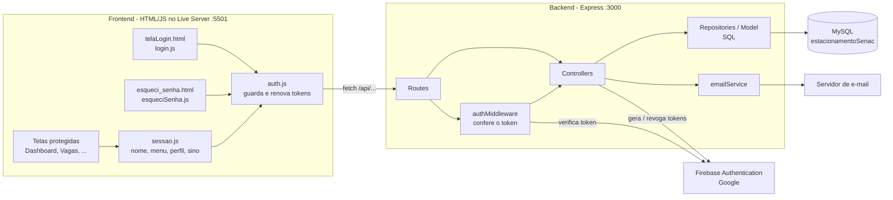
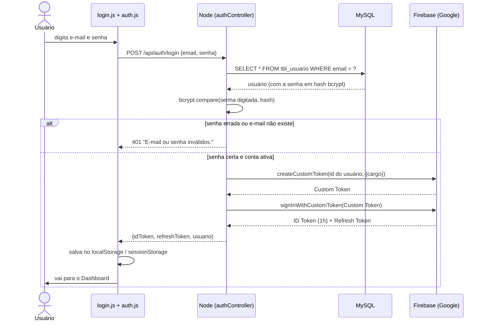
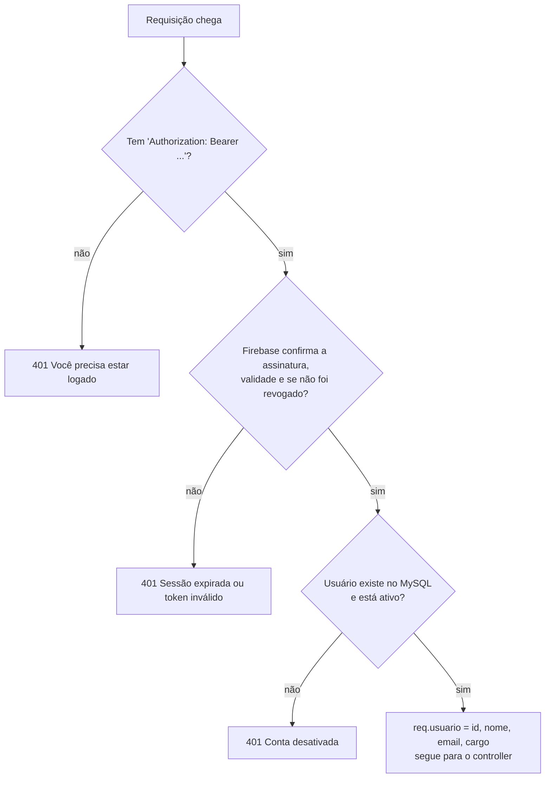
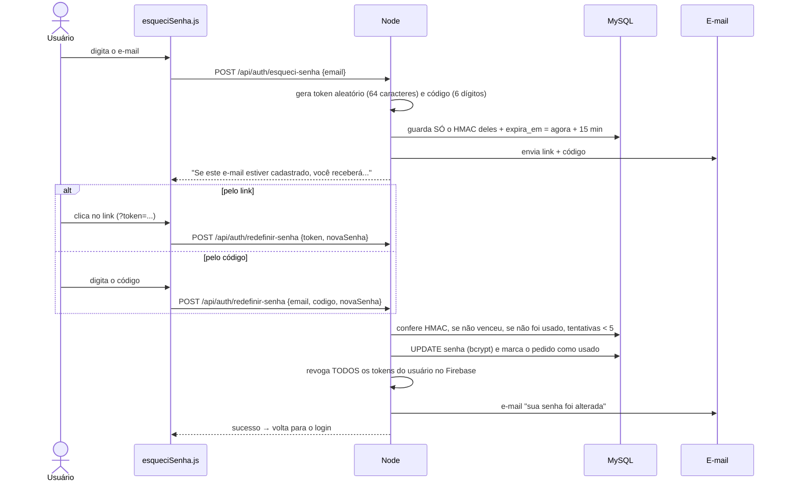
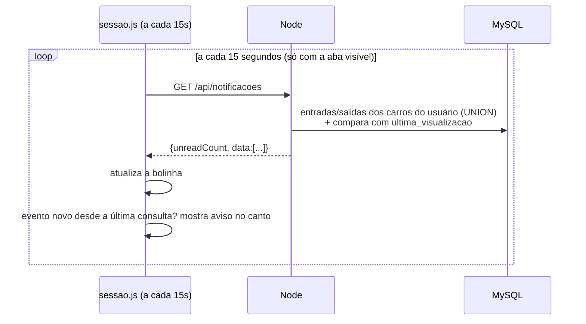
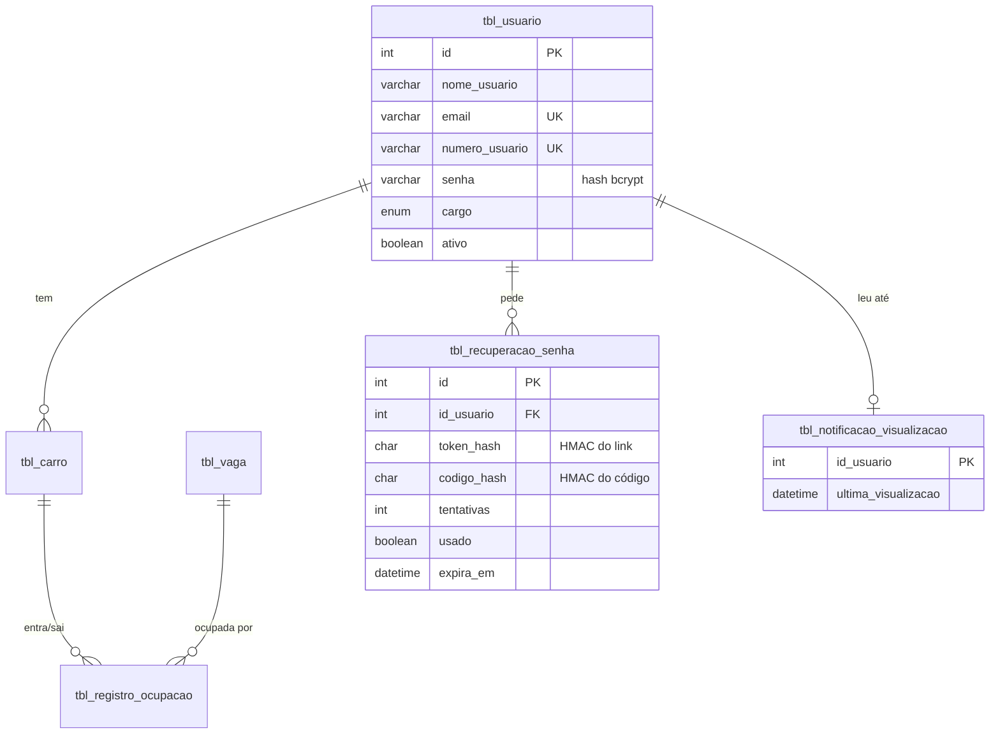

# Módulo de Login, Sessão, Perfil e Notificações

> Goiabinha&CIA — Estacionamento Inteligente (SENAC Taboão)
> Responsável por este módulo: login (backend + frontend), token do Firebase, recuperação de senha,
> notificações do sino e perfil do usuário em todas as telas.

---

## Sumário

1. [O que este módulo faz](#1-o-que-este-módulo-faz)
2. [Como rodar (passo a passo)](#2-como-rodar-passo-a-passo)
3. [Como provar que está funcionando](#3-como-provar-que-está-funcionando)
4. [Visão geral da arquitetura](#4-visão-geral-da-arquitetura)
5. [Como funciona o login (MySQL + Firebase)](#5-como-funciona-o-login-mysql--firebase)
6. [Os 3 tokens explicados](#6-os-3-tokens-explicados)
7. [Como as telas ficam protegidas](#7-como-as-telas-ficam-protegidas)
8. [Esqueci a senha (link ou código)](#8-esqueci-a-senha-link-ou-código)
9. [Notificações do sino](#9-notificações-do-sino)
10. [Perfil do usuário](#10-perfil-do-usuário)
11. [Banco de dados](#11-banco-de-dados)
12. [Segurança: o que foi feito e por quê](#12-segurança-o-que-foi-feito-e-por-quê)
13. [Arquivo por arquivo](#13-arquivo-por-arquivo)
14. [Rotas da API](#14-rotas-da-api)
15. [Como o resto do grupo usa o login nas suas telas](#15-como-o-resto-do-grupo-usa-o-login-nas-suas-telas)
16. [Firebase para o grupo todo](#16-firebase-para-o-grupo-todo)
17. [Perguntas que podem fazer na apresentação](#17-perguntas-que-podem-fazer-na-apresentação)
18. [Problemas comuns](#18-problemas-comuns)

---

## 1. O que este módulo faz

| Funcionalidade | Resumo |
|---|---|
| **Login** | E-mail (ou telefone) + senha. A senha é conferida no MySQL e o Firebase gera o token de acesso. |
| **Sessão** | Toda tela protegida verifica se o usuário está logado; se não estiver, volta para o login. O token é renovado sozinho. |
| **Lembrar-me** | Marcado: continua logado mesmo fechando o navegador. Desmarcado: sai ao fechar a aba. |
| **Esqueci a senha** | Chega um e-mail com **um link** e **um código de 6 dígitos**. O usuário usa o que preferir. |
| **Notificações** | O sino mostra quando um carro **do próprio usuário** entra ou sai do estacionamento. Aparece um aviso na tela em até 15 segundos. |
| **Perfil** | Clicando no nome/avatar: ver e editar dados, ver os veículos (e se estão estacionados), trocar a senha, sair. |

---

## 2. Como rodar (passo a passo)

**Pré-requisitos:** Node.js 20+, MySQL rodando, VS Code com a extensão **Live Server**.

```bash
# 1. Instalar as dependências (na pasta raiz do projeto)
npm install

# 2. Criar o arquivo de configuração
#    Copie .env.example para .env e preencha (principalmente DB_PASSWORD)
#    e coloque o arquivo projectparkingtoken.json na raiz (ver seção 16)

# 3. Criar o banco + dados de exemplo (não precisa abrir o Workbench)
npm run criar-banco -- exemplos

# 4. Ligar o backend
npm run dev

# 5. Abrir Frontend/Login/telaLogin.html com o Live Server (porta 5501)
```

**Usuários de exemplo** (criados pelo passo 3):

| E-mail | Senha | Cargo |
|---|---|---|
| `admin@goiabinha.com` | `Admin1234` | administrador (vê notificações de todos os carros) |
| `maria@goiabinha.com` | `Usuario1234` | usuário (tem 2 veículos, a moto está estacionada na A05) |

Para criar outros usuários (a senha precisa ir **criptografada**, por isso não dá para inserir direto no Workbench):

```bash
npm run criar-usuario -- "Nome Completo" email@exemplo.com SenhaForte123 administrador
```

---

## 3. Como provar que está funcionando

### Teste automático (o mais importante)

```bash
npm run testar
```

Ele cria um usuário, um carro e uma vaga **temporários**, testa o sistema inteiro pela API de verdade
(MySQL + Firebase) e no final **apaga tudo** o que criou. São **56 verificações**, por exemplo:

- senha errada é recusada, e a mensagem é a mesma para e-mail inexistente;
- o Firebase devolve o token e o `uid` do token é o `id` do MySQL;
- sem token ou com token falso a API bloqueia;
- o carro entra → a bolinha vai para 1; abre o sino → volta para 0; o carro sai → nova notificação;
- outro usuário **não** vê as notificações deste carro;
- código e link de recuperação funcionam **uma vez só**, código errado e link vencido são recusados;
- trocar a senha **derruba as sessões antigas**;
- conta desativada perde o acesso na hora.

Resultado esperado no final:

```
==========================================================
 🎉 TUDO FUNCIONANDO: 56 verificações passaram
==========================================================
```

### Teste manual na tela (roteiro para apresentar)

1. Abra `Frontend/index.html` **sem estar logado** → vai direto para a tela de login.
2. Entre com `maria@goiabinha.com` e uma senha errada → mensagem *"E-mail ou senha inválidos."*.
3. Entre com a senha certa → vai para o Dashboard e aparece **Maria Silva** no cabeçalho.
4. O sino mostra **3**. Clique: aparece a lista de entradas/saídas e a bolinha some.
5. Clique no nome → **Meus veículos** → a moto aparece *"Na vaga A05"*.
6. Navegue por outras telas → o nome continua lá (a sessão vale no sistema todo).
7. No Workbench, simule um carro entrando:
   ```sql
   USE estacionamentoSenac;
   INSERT INTO tbl_registro_ocupacao (id_carro, id_vaga, valor_hora, data_entrada)
   VALUES ((SELECT id FROM tbl_carro WHERE placa='ABC1D23'),
           (SELECT id FROM tbl_vaga WHERE codigo_vaga='A07'), 10, NOW());
   ```
   Em até 15 segundos aparece o aviso no canto da tela e a bolinha vai para 1.
8. Menu do usuário → **Sair** → tente abrir qualquer tela → volta para o login.
9. **Esqueci minha senha** → digite o e-mail → o link e o código aparecem no **terminal do backend**
   (ou chegam no e-mail, se o SMTP estiver configurado) → use o código para criar uma senha nova.

### Testar a API no Insomnia/Postman

```bash
npm run gerar-token -- maria@goiabinha.com
```

Copie o token e mande no cabeçalho: `Authorization: Bearer <token>`.
Exemplo: `GET http://localhost:3000/api/usuarios/perfil`.

---

## 4. Visão geral da arquitetura



O backend segue o padrão que o grupo já usava, em camadas:

| Camada | Pasta | Responsabilidade |
|---|---|---|
| **Routes** | `Backend/Routes` | Diz qual URL chama qual função e quais rotas exigem login. |
| **Middlewares** | `Backend/middlewares` | Roda **antes** do controller: confere o token. |
| **Controllers** | `Backend/Controllers` | Regras de negócio: valida dados, decide a resposta. |
| **Repositories / Model** | `Backend/Repositories`, `Backend/Model` | Só SQL. Nenhuma regra de negócio. |
| **Services** | `Backend/Services` | Coisas externas (envio de e-mail). |
| **Connection** | `Backend/Connection` | Conexão com MySQL (`db.js`) e Firebase (`firebase.js`). |

---

## 5. Como funciona o login (MySQL + Firebase)

**Ideia principal:** os usuários e as senhas ficam no **nosso MySQL** (a tabela `tbl_usuario` que o grupo
definiu). O **Firebase** é usado para gerar e conferir o **token** — o "crachá" que prova que a pessoa
fez login. Assim não precisamos inventar nosso próprio sistema de token (o que seria inseguro) e o
Google cuida da assinatura criptográfica.



Pontos importantes:

- **O `uid` do Firebase é o `id` do MySQL.** Por isso, quando o token chega no backend, sabemos
  exatamente qual linha da `tbl_usuario` é a pessoa.
- **O cargo (`usuario`/`administrador`) vai dentro do token** (custom claim), além de ser conferido no banco.
- A **senha nunca sai do backend** — nem o hash. O front só recebe `id, nome, email, telefone, cargo`.

---

## 6. Os 3 tokens explicados

| Token | Quem gera | Dura | Para que serve |
|---|---|---|---|
| **Custom Token** | Nosso Node (com a chave da conta de serviço) | 1h, mas é usado na hora | Um "voucher" que diz ao Firebase: *"confio nesta pessoa, é o usuário id X"*. |
| **ID Token** | Firebase | **1 hora** | O "crachá". Vai em toda requisição: `Authorization: Bearer <ID Token>`. É um **JWT** assinado pelo Google. |
| **Refresh Token** | Firebase | Até ser revogado | Serve **só** para pegar um ID Token novo quando o atual vence. |

**Renovação automática** (`auth.js`): antes de cada chamada, se o ID Token está para vencer (falta menos de
1 minuto), o front chama `POST /api/auth/refresh` com o Refresh Token e recebe um novo. Se mesmo assim a API
responder 401, ele tenta renovar uma vez e, se não der, manda para o login com *"Sua sessão expirou"*.
O usuário nunca percebe — só se ficar muito tempo sem usar ou se a senha for trocada.

---

## 7. Como as telas ficam protegidas

Toda tela protegida tem, antes do `</body>`:

```html
<script src="/Frontend/src/assets/js/auth.js"></script>
<script src="/Frontend/src/assets/js/sessao.js" defer></script>
```

**No frontend (`sessao.js`):**
1. Se não há sessão salva → redireciona para o login (guardando a página em `?voltar=` para voltar depois).
2. Preenche o nome no cabeçalho (`#nome-usuario`).
3. Pergunta ao servidor `GET /api/auth/me` se a sessão ainda vale (conta pode ter sido desativada).

**No backend (`authMiddleware.js`)** — a proteção de verdade (o front pode ser burlado, o backend não):



Também existe o `somenteAdmin`, para rotas que só o administrador pode usar (retorna 403 para os outros).

---

## 8. Esqueci a senha (link ou código)

O usuário recebe **um único e-mail** com **duas formas** de recuperar:

- **Link:** abre a tela já pronta, só pede a nova senha.
- **Código de 6 dígitos:** útil quando o e-mail é lido no celular e a tela está no computador.



Regras de segurança da recuperação:

| Regra | Por quê |
|---|---|
| Resposta **igual** exista ou não o e-mail | Ninguém descobre quais e-mails estão cadastrados. |
| No banco fica só o **HMAC** do link/código | Se alguém roubar o banco, não consegue usar os links (nem testar códigos, porque precisaria do `RESET_SECRET`). |
| Vale **15 minutos** e **uma vez só** | Link antigo esquecido no e-mail não serve para nada. |
| Pedir de novo **cancela** o pedido anterior | Só o último link/código vale. |
| **5 tentativas** erradas e o código morre | Impede chutar os 1.000.000 de combinações. |
| Limite de **5 pedidos / 15 min** por IP | Impede usar o sistema para mandar spam. |
| Trocar a senha **derruba todas as sessões** | Se alguém tinha roubado a sessão, perde o acesso. |
| O token é **removido da barra de endereço** | Não fica no histórico do navegador. |

**Sem SMTP configurado** (padrão em desenvolvimento), o e-mail é mostrado no **terminal do backend**.
Para enviar de verdade, preencha `SMTP_*` no `.env` (no Gmail: `smtp.gmail.com`, porta `465` e uma
*senha de app* da conta Google).

---

## 9. Notificações do sino

**De onde vêm:** da tabela `tbl_registro_ocupacao`, que as telas de Entrada/Saída e os sensores IoT preenchem.
Não existe tabela de notificações: **cada registro gera até 2 eventos** — a ENTRADA (`data_entrada`) e,
se já saiu, a SAÍDA (`data_saida`).

**Quem vê o quê:**
- **Usuário comum:** só os eventos dos **próprios carros** (`tbl_carro.id_usuario = id do logado`).
- **Administrador:** os eventos de **todos** os carros.

**Lida / não lida:** a tabela `tbl_notificacao_visualizacao` guarda, para cada usuário, a **última vez que
ele abriu o sino**. Tudo que aconteceu depois disso conta na bolinha vermelha. Abrir o sino chama
`POST /api/notificacoes/marcar-lidas`, que grava `NOW()`.



> **Por que *polling* (perguntar a cada 15s) e não tempo real?** É simples, funciona com o backend
> Express que já existe e não precisa de servidor de WebSocket. Para um estacionamento, 15 segundos de
> atraso é aceitável. Uma evolução futura seria usar WebSocket/Server-Sent Events.

---

## 10. Perfil do usuário

Clicando no nome/avatar (em **qualquer** tela) abre o menu:

- **Meu perfil** → editar nome, e-mail e telefone (`PUT /api/usuarios/perfil`). Se o e-mail ou telefone
  já for de outra conta, aparece aviso (o banco tem `UNIQUE`).
- **Meus veículos** → lista os carros do usuário com marca, modelo, placa, cor, ano e se está
  **estacionado** (e em qual vaga, desde que horas) ou **fora**.
- **Alterar senha** → pede a senha atual; ao trocar, sai de todos os dispositivos.
- **Sair** → apaga os tokens do navegador e volta para o login.

Na tela **Configurações**, o card *Minha conta* mostra os dados reais do logado.

---

## 11. Banco de dados

Arquivo: [`Backend/Database/estacionamentoSenac.sql`](../Backend/Database/estacionamentoSenac.sql).
Contém as tabelas definidas pelo grupo **sem alteração** e mais **2 tabelas novas** deste módulo:



- `tbl_recuperacao_senha` — pedidos de "esqueci minha senha".
- `tbl_notificacao_visualizacao` — até onde cada usuário já leu as notificações.

O script usa `CREATE ... IF NOT EXISTS`: rodar de novo **não apaga nada**.
[`dadosExemplo.sql`](../Backend/Database/dadosExemplo.sql) é opcional (usuários de teste, 20 vagas, tarifa, carros).

---

## 12. Segurança: o que foi feito e por quê

| Medida | Onde | Explicação simples |
|---|---|---|
| Senha com **bcrypt** (custo 12) | `authController.js` | A senha vira um "hash" que não dá para desfazer. Nem quem tem acesso ao banco sabe a senha. |
| **Mesma mensagem** para e-mail inexistente e senha errada | login | Não dá para descobrir quem tem conta. |
| **Mesmo tempo de resposta** nos dois casos (`HASH_FALSO`) | login | Sem isso, dava para descobrir pelo tempo (o bcrypt demora). |
| **Limite de tentativas** (10 logins errados / 15 min por IP) | `authRoutes.js` | Impede ataque de força bruta (testar milhares de senhas). |
| Senha forte: **8+ caracteres, letra e número** | backend **e** frontend | O front avisa rápido, mas quem garante é o backend. |
| Token assinado pelo **Google** (JWT) | Firebase | Ninguém consegue falsificar um token. |
| Token conferido em **toda** rota protegida + checa se foi **revogado** | `authMiddleware.js` | Não basta ter feito login um dia; o token precisa estar válido agora. |
| Conta **desativada perde o acesso na hora** | `authMiddleware.js` | O middleware consulta `ativo` no MySQL a cada requisição. |
| Trocar a senha **derruba as sessões** | `firebase.js → encerrarSessoes` | Se alguém roubou a sessão, perde o acesso. |
| **CORS** só para o nosso front | `app.js` | Outro site não consegue chamar a nossa API pelo navegador do usuário. |
| Limite de **10 KB** no corpo das requisições | `app.js` | Evita que mandem dados gigantes para travar o servidor. |
| **SQL com `?`** (parâmetros) em todas as consultas | Repositories | Impede *SQL Injection*. |
| **`textContent`** em vez de `innerHTML` com dados do usuário | `sessao.js` | Impede *XSS* (alguém cadastrar um nome com `<script>`). |
| Token **nunca** aparece no log | `authMiddleware.js` | Quem vê o terminal não consegue roubar sessões. |
| Só aceita voltar para páginas **do próprio sistema** | `login.js` (`?voltar=`) | Impede *open redirect* (link de login que joga para site falso). |
| `.env` e `projectparkingtoken.json` no **`.gitignore`** | raiz | Senhas e a chave do Firebase **não vão para o GitHub**. |

---

## 13. Arquivo por arquivo

### Backend

| Arquivo | O que faz |
|---|---|
| `Backend/Server/app.js` | Monta a API: CORS, JSON, e liga as rotas `/api/auth`, `/api/usuarios`, `/api/notificacoes`. |
| `Backend/Server/server.js` | Liga o `app.js` na porta do `.env` (3000). |
| `Backend/Connection/db.js` | Pool de conexões com o MySQL (mesmas variáveis `DB_*` que o resto do grupo usa). |
| `Backend/Connection/firebase.js` | Inicializa o Firebase Admin uma vez; funções para trocar o Custom Token pelo ID Token, renovar o token e **encerrar todas as sessões** de um usuário. |
| `Backend/middlewares/authMiddleware.js` | `verificarToken` (protege rotas) e `somenteAdmin`. Coloca `req.usuario` para os controllers. |
| `Backend/Routes/authRoutes.js` | Rotas de login/recuperação + limites de tentativas. |
| `Backend/Routes/usuarioRoutes.js` | Rotas do perfil (todas exigem login). |
| `Backend/Routes/notificacaoRoutes.js` | Rotas do sino (todas exigem login). |
| `Backend/Controllers/authController.js` | Login, refresh, esqueci/redefinir senha, alterar senha. |
| `Backend/Controllers/usuarioController.js` | Ver e editar o perfil. |
| `Backend/Controllers/notificacaoController.js` | Monta a lista de notificações e a contagem da bolinha. |
| `Backend/Repositories/usuarioRepository.js` | SQL da `tbl_usuario` (+ carros no perfil). |
| `Backend/Repositories/recuperacaoSenhaRepository.js` | SQL da `tbl_recuperacao_senha`. |
| `Backend/Model/notificacaoModel.js` | SQL das notificações (entradas/saídas + não lidas). |
| `Backend/Services/emailService.js` | Envia os e-mails (ou mostra no terminal se não houver SMTP). |
| `Backend/Database/estacionamentoSenac.sql` | Script do banco. |
| `Backend/Database/dadosExemplo.sql` | Dados de exemplo (opcional). |
| `Backend/Database/criarBanco.js` | `npm run criar-banco` — roda os SQL sem Workbench. |
| `Backend/Database/criarUsuario.js` | `npm run criar-usuario` — cria usuário com senha criptografada. |
| `Backend/Database/testarSistema.js` | `npm run testar` — o teste automático completo. |
| `gerarToken.js` | `npm run gerar-token` — gera um token para testar no Insomnia. |

### Frontend

| Arquivo | O que faz |
|---|---|
| `Frontend/src/assets/js/auth.js` | **Núcleo da sessão**: guarda/renova tokens, `Auth.fetch()`, `Auth.getUsuario()`, `Auth.sair()`. |
| `Frontend/src/assets/js/sessao.js` | Roda em toda tela protegida: bloqueia sem login, nome no cabeçalho, menu, perfil, sino, avisos. |
| `Frontend/src/styles/sessao.css` | Visual do menu, perfil e notificações (tema escuro e claro). |
| `Frontend/src/assets/js/login.js` | Tela de login: envia, mostra erros, mostrar/esconder senha, "lembrar-me". |
| `Frontend/src/assets/js/esqueciSenha.js` | Tela de recuperação: etapa do e-mail e etapa da nova senha (link ou código). |
| `Frontend/Login/telaLogin.html` | Tela de login. |
| `Frontend/esqueciSenha/esqueci_senha.html` | Tela de recuperação de senha. |

---

## 14. Rotas da API

Base: `http://localhost:3000/api`. 🔒 = precisa do cabeçalho `Authorization: Bearer <ID Token>`.

| Método | Rota | Corpo | Resposta (sucesso) |
|---|---|---|---|
| POST | `/auth/login` | `{ email, senha }` | `{ idToken, refreshToken, expiresIn, usuario }` |
| POST | `/auth/refresh` | `{ refreshToken }` | `{ idToken, refreshToken, expiresIn, usuario }` |
| GET 🔒 | `/auth/me` | — | `{ usuario: { id, nome, email, cargo } }` |
| PUT 🔒 | `/auth/senha` | `{ senhaAtual, novaSenha }` | `{ mensagem }` (todas as sessões caem) |
| POST | `/auth/esqueci-senha` | `{ email }` | `{ mensagem }` (sempre a mesma) |
| POST | `/auth/redefinir-senha` | `{ token, novaSenha }` **ou** `{ email, codigo, novaSenha }` | `{ mensagem }` |
| GET 🔒 | `/usuarios/perfil` | — | `{ data: { nome, email, telefone, cargo, dataCadastro, carros: [...] } }` |
| PUT 🔒 | `/usuarios/perfil` | `{ nome, email, telefone }` | `{ usuario }` |
| GET 🔒 | `/notificacoes` | — | `{ unreadCount, data: [{ tipo, placa, mensagem, data_evento, naoLida }] }` |
| POST 🔒 | `/notificacoes/marcar-lidas` | — | `{ message }` |

Erros sempre no formato `{ "success": false, "erro": "mensagem" }`, com o código HTTP certo
(400 dados inválidos, 401 sem login, 403 sem permissão, 409 duplicado, 429 tentativas demais, 500 erro interno).

---

## 15. Como o resto do grupo usa o login nas suas telas

**No frontend**, troque `fetch` por `Auth.fetch` — ele já coloca o token e renova quando vence:

```js
// antes
const resposta = await fetch('http://localhost:3000/vagas');
// depois (caminho relativo = http://localhost:3000/api/...)
const resposta = await Auth.fetch('/vagas');
// ou com URL completa, se a rota não estiver em /api
const resposta = await Auth.fetch('http://localhost:3000/dashboard');

const usuario = Auth.getUsuario();   // { id, nome, email, telefone, cargo }
if (usuario.cargo === 'administrador') { /* ... */ }
```

Esconder algo de quem não é administrador: basta colocar `data-somente-admin` no elemento HTML.

**No backend**, proteja a rota e use `req.usuario`:

```js
const { verificarToken, somenteAdmin } = require('../middlewares/authMiddleware');

router.get('/', verificarToken, controller.listar);                     // qualquer logado
router.delete('/:id', verificarToken, somenteAdmin, controller.apagar); // só administrador

// dentro do controller
const idDoUsuarioLogado = req.usuario.id;
```

---

## 16. Firebase para o grupo todo

O backend precisa de **2 coisas secretas** que **não vão para o GitHub**:

1. **`projectparkingtoken.json`** — a chave da *conta de serviço* do Firebase. Com ela o Node consegue
   criar tokens. **Quem tiver esse arquivo controla o login do projeto**, por isso ele é secreto.
2. **`.env`** — senhas do banco, chave web do Firebase e o `RESET_SECRET`.

**Como o grupo usa o MESMO Firebase:**

- **Opção A (mais simples):** quem criou o projeto no Firebase manda o `projectparkingtoken.json` e os
  valores do `.env` **em particular** (WhatsApp/Drive privado do grupo — nunca no GitHub). Cada um coloca
  os dois na raiz do projeto e muda só o `DB_PASSWORD` para a senha do próprio MySQL.
- **Opção B (mais organizada):** no [Console do Firebase](https://console.firebase.google.com) →
  ⚙️ *Configurações do projeto* → *Usuários e permissões* → adicionar o e-mail de cada integrante.
  Depois cada um baixa a própria chave em *Contas de serviço* → *Gerar nova chave privada*.

> Os usuários (e-mails e senhas) ficam no **MySQL de cada um**, não no Firebase. Então cada computador
> precisa rodar `npm run criar-banco -- exemplos` (ou criar seus usuários).

---

## 17. Perguntas que podem fazer na apresentação

**Por que usar o Firebase se as senhas estão no MySQL?**
Porque criar e validar tokens com segurança é difícil. O Firebase gera tokens JWT assinados pelo Google,
renova e revoga. Nós cuidamos dos dados (MySQL) e o Google cuida da parte criptográfica do token.

**O que é um JWT?**
Um texto em 3 partes (`cabeçalho.dados.assinatura`) separadas por ponto. Os dados (id do usuário, cargo,
validade) podem ser lidos, mas não alterados: se mudar uma letra, a assinatura não confere.

**Por que bcrypt e não guardar a senha normal?**
Se o banco vazar, as senhas não aparecem. O bcrypt também é **lento de propósito**, o que torna inviável
testar milhões de senhas.

**E se alguém roubar o token?**
Ele vale no máximo 1 hora. Trocar a senha ou desativar a conta derruba o acesso na hora.

**Por que o link e o código ficam "embaralhados" (HMAC) no banco?**
Mesmo motivo da senha: se alguém ler o banco, não consegue usar os links de recuperação pendentes.

**Por que a mensagem de erro do login não diz "usuário não encontrado"?**
Para um atacante não descobrir quais e-mails têm conta no sistema.

**Como a notificação sabe que o carro entrou?**
Quando a tela de Entrada/Saída (ou o sensor) grava em `tbl_registro_ocupacao`, o sino consulta a cada 15
segundos e compara com a última vez que o usuário abriu o sino.

**Por que o código (6 dígitos) não pode ser chutado?**
São 1.000.000 de combinações, o código morre depois de 5 erros, vence em 15 minutos e cada IP só pode
pedir 5 códigos a cada 15 minutos.

---

## 18. Problemas comuns

| Problema | Solução |
|---|---|
| `npm run testar` diz *"o MySQL recusou a senha"* | Confira `DB_USER` e `DB_PASSWORD` no `.env`. |
| *"o banco não existe"* | `npm run criar-banco -- exemplos`. |
| Tela de login diz *"Não foi possível conectar ao servidor"* | O backend não está ligado: `npm run dev`. |
| Erro de **CORS** no console do navegador | Abra o front pelo Live Server na porta **5501**, ou adicione a sua porta em `CORS_ORIGINS` no `.env`. |
| Login funciona mas logo volta para o login | O relógio do computador pode estar muito errado. Ajuste em *Configurações do Windows → Hora e idioma → Sincronizar agora*. |
| `Cannot find module '../../projectparkingtoken.json'` | Falta a chave do Firebase na raiz (seção 16). |
| E-mail de recuperação não chega | Sem SMTP no `.env`, ele aparece no **terminal do backend**. |
| *"Muitas tentativas"* | Espere 15 minutos ou reinicie o backend (o contador fica na memória). |
